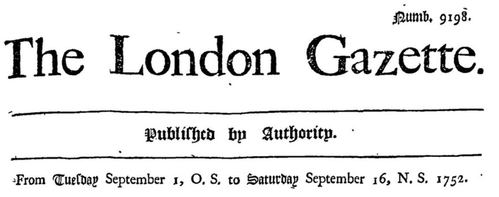

## Origin


```{python}
from ipyleaflet import Circle, LayersControl, Map, Marker, ScaleControl, TileLayer, basemaps, basemap_to_tiles

cht = (51.62315272689227, -0.5185542750309865)
hh90 = (51.51826807181277, -0.11807725782907953)
splodges = (cht,)
markers = (hh90,)

m = Map(
    center=(51.57, -0.25),
    zoom=10,
)
m.layout.width = "850px"
m.layout.height = "550px"

for splodge in splodges:
    radius, opacity = (12000, 0.35)
    m.add(Circle(location=splodge, radius=radius, stroke=False,
                fill_color="orange", fill_opacity=opacity))
for marker in markers:
    m.add_layer(Marker(location=marker))

m.add(ScaleControl(position="bottomleft"))
m
```

::: {.notes}
Most of my early life and schooling took place inside this orange circle.
:::

## Brief career highlights

- Computer Science BSc — Warwick University 
- Citrix Systems
- Bioinformatics MSc — King's College London
- Anthony Nolan Research Institute (first RSE job!)
- UCL RITS/ARC

## About me {.icons}

:::: {.columns}

::: {.column width="70%"}
   

   

    

    


:::

::: {.column width="30%"}
{fig-alt="Overhead photo of a woodland floor of dark soil and bright green moss, with a few twigs, an oak leaf and an acorn at the edges. In the centre is a large, rounded, pale cream earthball fungus with a rough, scaly, speckled surface. Four golden-yellow parasitic bolete mushrooms with glossy orange-brown caps and stout yellow stems grow from around it: two at the top, one with a large cap and one smaller, and two at the bottom with their rounded caps pressed together side by side." height="400"}
:::

::::

## Emap Waveform Exporter


```{mermaid}
%%| fig-alt: "Diagram of the Emap waveform data flow. Inside a large box labelled UCLH, a box labelled 'machines that go ping' has an arrow to a box labelled GAE. An arrow leads from GAE to a box labelled DSH, which sits inside a separate box labelled UCL."
%%{init: {"themeVariables": {"fontSize": "24px"}}}%%
flowchart LR
    subgraph UCLH
        direction LR
        M["machines that go <em>ping</em><br/>(ECG, ventilator, etc)"] --> G["GAE"]
    end
    subgraph UCL
        D["Data Safe Haven"]
    end
    G --> D
    classDef node fill:#ffffff,stroke:#222222,stroke-width:2px,color:#000000
    class M,G,D node
    style UCLH fill:#fff4cc,stroke:#222222,stroke-width:2px,color:#000000
    style UCL fill:#d9ecff,stroke:#222222,stroke-width:2px,color:#000000
```


* Repo links
    * [Emap repo](https://github.com/SAFEHR-data/emap)
    * [Waveform controller repo](https://github.com/SAFEHR-data/waveform-controller)

# Calendar systems

There have been *a lot* through history. Here are three.

::: {.notes}
This is going to be quite euro-centric.
:::

## Why

Connecting Histories, Connecting Heritage: Early Modern Cities and Their Afterlives 

::: {.notes}
We made a Django site to collect historical documents, and many 
:::

## PostgreSQL date types

> Dates are counted according to the Gregorian calendar, even in years before that calendar was introduced

https://www.postgresql.org/docs/18/datatype-datetime.html

::: {.notes}
Did not expect this to ever be a problem!
:::

## Why are 11 days missing?

```{.bash code-line-numbers="false"}
$ cal -m 9 1752
   September 1752     
Su Mo Tu We Th Fr Sa  
       1  2 14 15 16  
17 18 19 20 21 22 23  
24 25 26 27 28 29 30  
```

::: {.notes}
The "2" and the "14" are not in the same calendar system.

But that's when Britain and its empire switched from the Julian to Gregorian Calendar,
AND changed the start of the year from 25th March to 1st January.

The utility cal was written for Unix so tracks the US calendar system.
(Changing your locale does not affect its output)
The US system follows the British system, since it was part of the British Empire at the time.
:::

## Calendar (New Style) Act 1750
::: {.incremental}
* British Empire moves from Julian to a calender identical to the Gregorian calendar
* New year's day moves from 25th March to 1st January
* September 1752 gets a bit of a trim
* 1751 loses three months altogether(!)
:::

::: {.fragment}
{fig-alt="An issue of The London Gazette spanning the changeover date" height="200"}
:::


::: {.notes}

:::


## Gregorian calendar

* It's mainly about leap days (and Easter)

::: {.fragment}
| According to | Rotations in a solar orbit | Extra days |
| --- | ---: | --- |
| Julian Calendar | $365.2500$ | $\frac{1}{4}$ |
| Gregorian Calendar | $365.2425$ | $\frac{1}{4} - \frac{1}{100} + \frac{1}{400}$ |
| The actual earth | $\approx 365.2422$ | |
:::


::: {.incremental}
* First adopted **Friday 15 October 1582**
:::

::: {.notes}
First day of the new Gregorian calendar was Friday 15 October 1582.
444 years and 5 days ago!

Julian takes ~128 years to accumulate one day of discrepancy.
Gregorian takes ~3000 years.

Thursday 4 October 1582 was followed by Friday 15 October 1582.

They jumped forward, missing out 10 days.

:::

## Summary

One row == one adjacent day

| Britain (Julian, year starts 25 March) |  Britain (Julian, year starts 1 Jan) | More Veneto(Julian, year starts 1 March) | Gregorian |
| --- | --- | --- | --- |
| <mark>31 Dec 1751</mark> | 31 Dec 1751 | 31 Dec 1751 | 11 Jan 1752 |
| 1 Jan 1751 | <mark>1 Jan 1752</mark> | 1 Jan 1751 | 12 Jan 1752 |

(highlighted = local date in use on that day)

## Conversion in Python

Python package called `convertdate`

```{python}
#| echo: true
#| output: true
import convertdate

julians = ((1752, 9, 2), (1752, 9, 3))
for jul in julians:
    greg = convertdate.julian.to_gregorian(*jul)
    print(f"{jul} -> {greg}")
```

## Yet more calendars...

```
>>> import convertdate
>>> convertdate.
convertdate.armenian           convertdate.indian_civil       
convertdate.bahai              convertdate.islamic            
convertdate.coptic             convertdate.iso                
convertdate.data               convertdate.julian             
convertdate.daycount           convertdate.julianday          
convertdate.dublin             convertdate.mayan              
convertdate.french_republican  convertdate.ordinal            
convertdate.gregorian          convertdate.persian            
convertdate.hebrew             convertdate.positivist         
convertdate.holidays           convertdate.utils              
```

# Weeknotes?

## Why

* More problem oriented

## Thanks

Questions?
